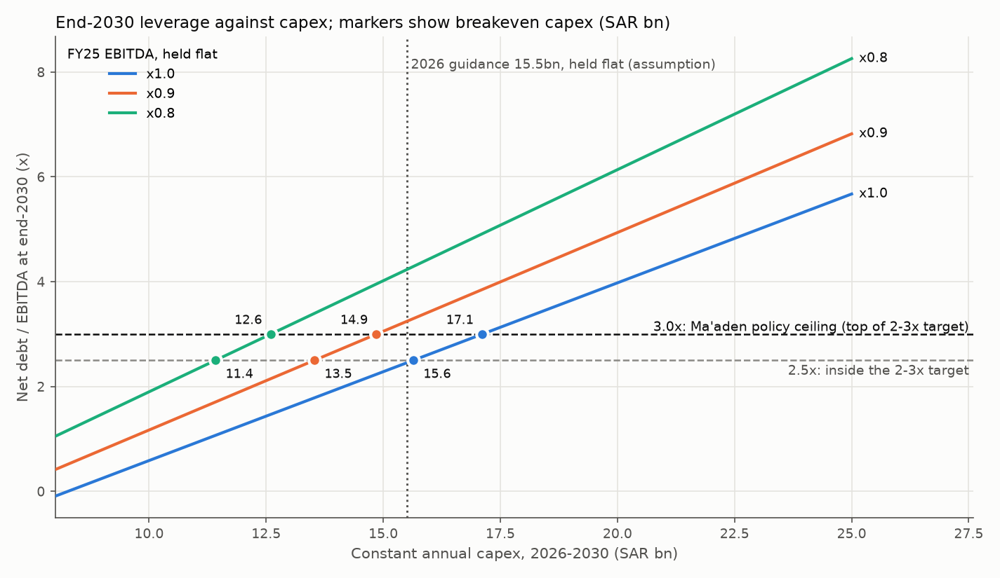
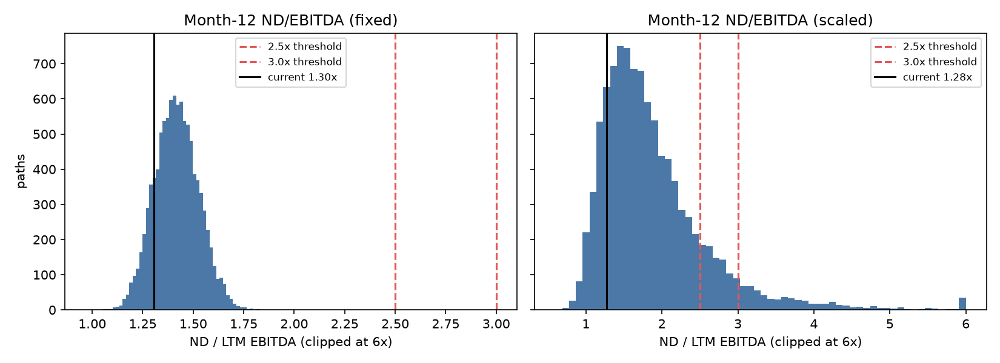

# Ma'aden capex financing stress test

Credit model for Ma'aden. Course project, INDENG 174. Plan: [maaden-build-plan.md](maaden-build-plan.md).

## Credit core (deterministic, FY25 audited base)

How much capex can Ma'aden carry before leverage crosses its own ceiling? Base: audited balance sheet at 31-Dec-25, FY25 group EBITDA of SAR 16,159m. SAR m unless stated.

| Metric | Value |
|---|---|
| Net debt, leases excluded (company definition) | 21,626.45 |
| Net debt / EBITDA | 1.338x |
| Net debt / EBITDA incl. leases | 1.426x |
| EBITDA fall to reach 2.5x / 3.0x | 46.5% / 55.4% |
| Interest cover, on borrowings interest / on total finance cost | 8.76x / 7.44x |
| Liquidity (cash + time deposits + undrawn facilities) | 25,252.97 |
| Floating share of principal | 82.6% |

**Breakeven capex.** Constant annual capex over 2026-2030 at which end-2030 net debt / EBITDA crosses the threshold (SAR m per year). 2026 guidance is 15,500; holding it flat is an assumption.

| EBITDA scenario | Breakeven at 2.5x | Breakeven at 3.0x | First breach year at 3.0x | 3.0x with +100 bp on floating share |
|---|---|---|---|---|
| FY25 EBITDA flat | 15,639 | 17,113 | 2030 | 16,817 |
| x0.9 | 13,528 | 14,855 | 2030 | 14,571 |
| x0.8 | 11,416 | 12,596 | 2030 | 12,325 |

2026 capex guidance (SAR 15,500m) sits about 10% below the 3.0x breakeven of SAR 17,113m.

**Rate sensitivity.** +100 bp on the floating share costs SAR 268.7m a year on today's principal and lowers the flat-EBITDA 3.0x breakeven from 17,113 to 16,817. Applied to all debt it would be 16,755.

**Maturity wall.** 23.4% of principal falls due in 2030.

| Year | Principal | Share |
|---|---|---|
| 2026 | 2,807.08 | 8.6% |
| 2027 | 2,631.61 | 8.1% |
| 2028 | 3,147.43 | 9.7% |
| 2029 | 4,323.25 | 13.3% |
| 2030 | 7,622.71 | 23.4% |
| 2031+ | 11,996.75 | 36.9% |



Excel version: [results/maaden_credit_model.xlsx](results/maaden_credit_model.xlsx). Formulas not machine-verified in a spreadsheet engine (`docs/decisions.md` section 22).

**Caveats**

- EBITDA is flat at FY25 (or a fixed multiple of it). Not a forecast.
- No EBITDA from new capacity, which is conservative: capex adds debt but earns nothing inside the horizon.
- Refinancing is assumed: maturities roll, so gross debt moves with free cash flow only.
- FY25 balance sheet; H1-26 is pending.
- Covenants are undisclosed. 3.0x is the top of management's target range, a management ceiling and not a covenant.

## Price-module prototype (v0.1)

A 12-month aluminium price module, built first as a prototype. It has no cash-flow waterfall and is not the credit result above.

### What v0.1 does

- Aluminium price: GBM, zero drift, fit on Pink Sheet monthly prices (sigma = 0.1590), 10,000 paths with antithetic pairs, 12 monthly steps from 2026-10-01.
- Aluminium EBITDA: unit-cost model (b = 1.0632, c = 2,208 USD/t produced), calibrated on H1-26.
- LTM EBITDA from 12 months of history (reported quarters, then model on actual prices) plus simulated months.
- Group EBITDA two ways: `fixed` (non-Al LTM held constant, lower bound on volatility) and `scaled` (Al LTM / Al share, upper bound).
- Net debt held at the 31-Dec-25 audited value, excluding leases (21,626.45 SAR m).
- Quarterly covenant-style test (months 3, 6, 9, 12) at 2.5x and 3.0x.

### What v0.1 does not do

- No other commodities, no correlation, no OU, no disruptions, no policies.
- No cash-flow waterfall: net debt does not move (no capex, interest, tax, dividends).
- Thresholds are analyst assumptions; covenant levels are not disclosed.
- Net debt anchor is 31-Dec-25 (H1-26 balance sheet not yet obtained).
- The unit-cost model does not back-test well outside H1-26 (below).

### Results (seed 42, git 01d9947)

Current leverage: fixed 1.305x, scaled 1.277x, reported-basis (LTM to Q2-26) 1.317x.

| | fixed | scaled |
|---|---|---|
| P(breach 2.5x), quarterly test (95% CI) | 0 of 10,000 (p < 0.0003) | 0.1449 [0.1386, 0.1512] |
| P(breach 3.0x), quarterly test | 0 of 10,000 (p < 0.0003) | 0.0661 [0.0614, 0.0708] |
| P(breach 2.5x), annual test | 0 of 10,000 (p < 0.0003) | 0.1449 [0.1386, 0.1512] |
| P95 leverage, month 12 | 1.599x | 3.197x |
| Median leverage, month 12 | 1.415x | 1.713x |



Margin back-test (model at period-average Pink Sheet price, Q = production, SAR m):

| Period | Predicted | Actual | Error |
|---|---|---|---|
| Q4-25 | 774 | 1,617 | -52.1% |
| Q3-25 | 532 | 755 | -29.6% |
| FY25 | 2,211 | 3,842 | -42.5% |
| FY24 | 1,346 | 2,950 | -54.4% |

## How to run

```
python -m venv .venv && .venv/Scripts/pip install -r requirements.txt   # Python 3.11+
pytest
python scripts/run_all.py        # writes results/*.json, tables, figures and the Excel model
python scripts/build_readme.py   # regenerates this file from the result files
```

`run_all.py` never fetches data. Inputs are in `inputs/` (sourced, see `assumptions.csv`); modeling choices in `docs/decisions.md`.
